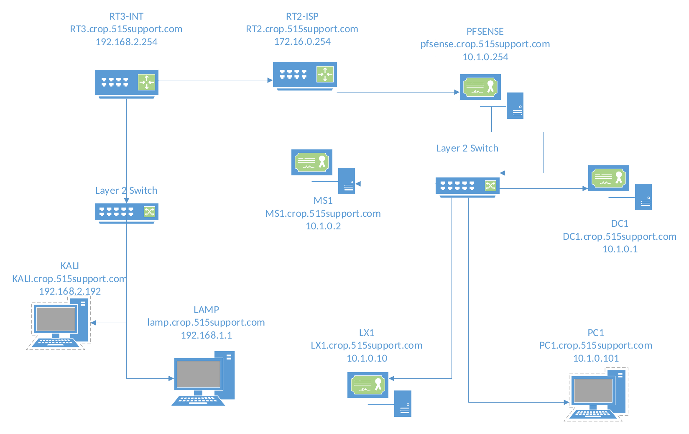

# Perimeter Defense with pfSense: Firewall Rules, NAT, Suricata IPS, and DoS Testing


A network defense project in which I put a pfSense firewall between a corporate LAN and a simulated internet, configured it from scratch, and then attacked it. I published an internal web server through NAT port forwarding, blocked a hostile subnet with a firewall rule, turned on the Suricata IDS/IPS to detect and block scanning, and finally stress-tested the firewall with two denial-of-service tools to see how it held up and where it broke.

The environment models a small company, `corp.515support.com`, whose LAN sits behind pfSense. Beyond the firewall, a chain of routers forms an "internet" containing a public web server and an attacker running Kali Linux.

---

## Table of Contents

- [Highlights](#highlights)
- [Network Topology](#network-topology)
- [Getting to Know pfSense](#getting-to-know-pfsense)
- [Publishing a Web Server with NAT](#publishing-a-web-server-with-nat)
- [Blocking a Hostile Network](#blocking-a-hostile-network)
- [Adding Suricata IDS/IPS](#adding-suricata-idsips)
- [Stress-Testing with DoS Attacks](#stress-testing-with-dos-attacks)
- [What I Learned](#what-i-learned)

---

## Highlights

A port-forwarding rule made an internal web server reachable from the internet through the firewall's single public address. A single block rule placed at the top of the ruleset cut the attacker's entire subnet off and logged every attempt. With Suricata in blocking mode, the attacker was shut out the moment its first probes were detected, leaving an Nmap scan with almost nothing to work with. Turning blocking off showed the difference: the same scan then pulled the web server's HTTP headers. In the DoS tests, a raw TCP flood from LOIC barely affected the firewall, but an `hping3` SYN flood with spoofed sources filled pfSense's state table and made its web interface unresponsive until the attack stopped.

---

## Network Topology



| VM | OS | IP Address | Role |
|----|----|-----------|------|
| PFSENSE | pfSense (FreeBSD) | LAN 10.1.0.254 / WAN 172.16.0.254 | Firewall and UTM between the LAN and the ISP network |
| RT2-ISP | VyOS | 172.16.0.253 | ISP router; pfSense's default gateway |
| RT3-INT | VyOS | 192.168.1.254 / 192.168.2.254 | "Internet" router connecting the two external subnets |
| DC1 | Windows Server 2016 | 10.1.0.1 | Active Directory and DNS |
| MS1 | Windows Server 2016 | 10.1.0.2 | IIS web server |
| LX1 | CentOS Linux | 10.1.0.10 | Internal web server published through NAT |
| PC1 | Windows 10 | 10.1.0.101 | Admin workstation used to manage pfSense |
| LAMP | Ubuntu Linux | 192.168.1.1 | External web and DNS server for `515web.net` |
| KALI | Kali Linux | 192.168.2.192 | Attacker on the "internet" side |

---

## Getting to Know pfSense

From PC1, I signed in to the pfSense WebConfigurator at `http://10.1.0.254` and worked through the tools an administrator relies on day to day:

| Area | What it showed |
|------|----------------|
| Dashboard | LAN and WAN interface addresses, system health |
| Diagnostics → Routes | The routing table, with RT2-ISP (172.16.0.253) as the default gateway |
| Diagnostics → mtr | A live trace to `www.515web.net`, out through RT2-ISP and RT3-INT to the LAMP server |
| Status → Interfaces / Monitoring / Traffic Graph | Packets allowed and blocked per interface, CPU load by process, and bandwidth use |
| Status → System Logs | System events and firewall rule matches |
| Diagnostics → States | The state table of active connections the firewall is tracking |

I also turned on logging for packets matched by the default pass rules and walked through the remote syslog settings. pfSense keeps logs in memory only, so in production you would forward them to a syslog server or SIEM to keep them.

---

## Publishing a Web Server with NAT

pfSense automatically creates **outbound NAT** so every LAN host can reach the internet through the firewall's single WAN address. Inbound traffic is a different story: nothing outside can reach a LAN host unless the firewall is told where to send it. To publish LX1's website, I created a **port forward**:

| Setting | Value |
|---------|-------|
| Destination | WAN address |
| Destination port | HTTP (80) |
| Redirect target IP | 10.1.0.10 (LX1) |
| Redirect target port | HTTP (80) |
| Description | Web server access |

After updating the external DNS records on the LAMP server so `515support.com` pointed to the firewall's public address, I browsed to the site from Kali and reached the web server's Apache test page, confirming the port forward worked. pfSense also added a matching pass rule to the WAN firewall rules automatically.

**Port forwarding vs. 1:1 NAT.** A port forward exposes only specific ports on a shared public address. If a server needed its own dedicated public IP, with all traffic to that address mapped to its private one, **1:1 NAT** would be the right choice instead.

---

## Blocking a Hostile Network

Next I treated the attacker's subnet as hostile and blocked it with a WAN rule:

| Setting | Value |
|---------|-------|
| Position | **Top of the list** |
| Action | Block |
| Protocol | Any |
| Source | 192.168.2.0/24 |
| Log | Enabled |
| Description | Blacklist 192.168.2.0 net |

Browsing to `http://www.515support.com/dvwa` from Kali now failed, and the firewall log showed each blocked connection attempt from `192.168.2.192` on port 80.

**Why rule order matters.** pfSense evaluates rules from the top down and stops at the first match. The port forward had already added a rule that *allows* HTTP from anywhere, so if the block rule sat below it, Kali's web traffic would match the allow rule first and never reach the block. Placing the block rule at the top makes sure it's evaluated first.

**Block vs. reject.** *Block* silently drops packets, so the sender gets no response and has to wait for a timeout. *Reject* sends back a refusal. Silent dropping gives an attacker less information, which is why it's the usual choice on an internet-facing interface.

**Bogon filtering.** The WAN interface also has a default rule that blocks **bogon networks**: address ranges that are reserved or not yet allocated by IANA and should never appear as a source on the public internet. Traffic from those ranges is almost always spoofed, so dropping it at the edge removes a common source of malicious traffic for free.

Afterward, I disabled the block rule so the attacker could reach the firewall for the next tests.

---

## Adding Suricata IDS/IPS

pfSense can run **Suricata**, an open-source IDS/IPS, as an add-on package. I enabled it on the WAN interface, sent its alerts to the system log, and turned on **Block Offenders**, which turns detection into prevention by automatically blocking any host that triggers an alert.

**Scanning with blocking on.** From Kali, a normal Zenmap scan of the firewall's WAN address returned nothing, because pfSense doesn't answer pings. Adding `-Pn` forced Nmap to scan anyway:

```bash
nmap -T4 -A -v -Pn 172.16.0.254
```

The results were thin: OS detection was unreliable, and there was little for an attacker to go on. Suricata's alerts explained why. It had logged only a few ICMP packets, and its **Blocks** tab showed Kali had been blocked as soon as that first traffic was detected, so the rest of the scan never got through.

**Scanning with blocking off.** I then disabled Block Offenders and restarted Suricata. The same scan now retrieved and analyzed the HTTP headers returned by the web server, a clear before-and-after demonstration of an IPS's value.

**Web vulnerability scan.** Finally, I ran Nikto against the firewall's public address:

```bash
nikto -host 172.16.0.254
```

Suricata flagged several invalid uses of HTTP but didn't identify Nikto by name. A subscriber ruleset would likely give more specific matches. Detection depends on the quality of the signatures you feed it.

---

## Stress-Testing with DoS Attacks

The last test was whether the firewall itself could be knocked over.

**LOIC TCP flood.** I pointed the Low Orbit Ion Cannon (LOIC) at the firewall's WAN address and launched a TCP flood. The WebConfigurator stayed responsive, and Suricata raised alerts about invalid ACK packets. Watching Status → Monitoring, the Traffic Graph, and Diagnostics → States showed the extra CPU and bandwidth load, but a single attacking VM simply didn't have enough resources to overwhelm the firewall. That's the reason real DoS attacks are *distributed* across botnets.

**hping3 SYN flood.** A SYN flood works differently. Instead of using up bandwidth, it attacks the firewall's **state table**:

```bash
hping3 -c 1000 -d 120 -S -w 64 -p 80 --flood --rand-source 172.16.0.254
```

| Flag | Purpose |
|------|---------|
| `-S` | Send TCP SYN packets, opening half-finished handshakes |
| `-p 80` | Target the published web port |
| `-d 120` | Add 120 bytes of data to each packet |
| `-w 64` | Set the TCP window size |
| `--flood` | Send as fast as possible without waiting for replies |
| `--rand-source` | Spoof a random source IP on every packet |

Every spoofed SYN creates a new entry in the state table that never completes. As the table filled, the WebConfigurator on PC1 slowed down and then stopped loading entirely, returning *This page can't be displayed*. Once I stopped the attack, it recovered within moments. Diagnostics → States was still full of SYN_SENT and half-open connections from random source addresses, the leftovers of the flood.

The contrast between the two attacks was the key lesson: raw volume from one machine did little, but an attack aimed at a specific finite resource, the state table, brought the management interface down from a single VM.

---

## What I Learned

This project showed how much of a firewall's job comes down to careful configuration. NAT decides what's reachable from outside, and rule order decides what actually happens to traffic: a correct block rule in the wrong position does nothing at all. Logging and the diagnostic tools turned out to be just as important as the rules, since they're how you prove a rule works and spot when something is wrong.

Suricata showed the practical difference between detection and prevention. With blocking on, the attacker learned almost nothing; with it off, the same scan gathered real information. It also showed that an IDS is only as good as its signatures, since Nikto went unidentified on the free ruleset.

The DoS tests were the most eye-opening. A firewall that shrugged off a brute-force flood could still be taken down by an attack aimed at its state table. Defending against that takes more than rules: tuning state-table limits and timeouts, SYN-flood protections, rate limiting, and, for large-scale attacks, upstream DDoS mitigation.

---

## Author

**Geoffrey Mackey**, Cybersecurity and Information Technology student at the University of Cincinnati.
